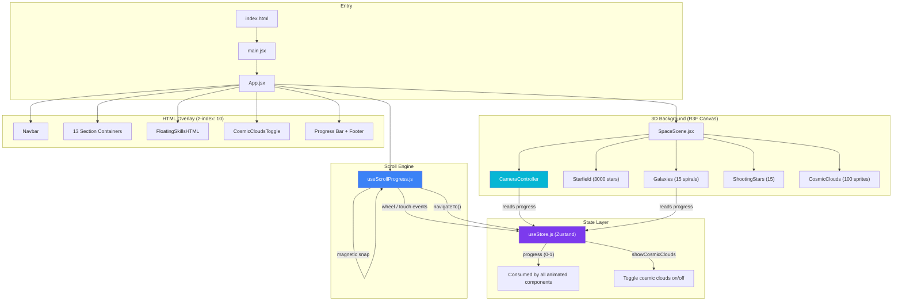
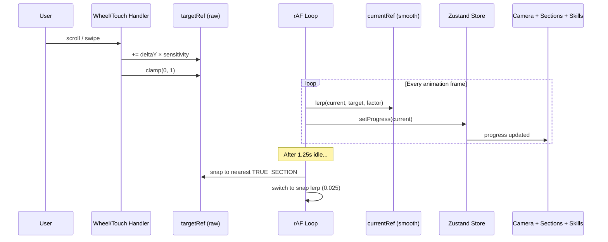
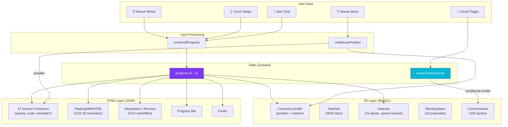

# 🚀 MyPortfolio — Complete Technical Documentation

> **Author:** Chirag Gajare  
> **Type:** Personal Portfolio Website  
> **Theme:** Cosmic / Space fly-through  
> **Generated:** November 8, 2026

---

## Table of Contents

1. [Overview](#overview)
2. [Tech Stack & Dependencies](#tech-stack--dependencies)
3. [Project File Structure](#project-file-structure)
4. [Architecture Overview](#architecture-overview)
5. [User Experience — How the Website Works](#user-experience--how-the-website-works)
6. [The Scroll System (Core Engine)](#the-scroll-system-core-engine)
7. [The 3D Space Scene](#the-3d-space-scene)
8. [The Camera Flight Path & Zoom System](#the-camera-flight-path--zoom-system)
9. [Section-by-Section Breakdown](#section-by-section-breakdown)
10. [The CSS 3D Skills Fly-Through](#the-css-3d-skills-fly-through)
11. [State Management (Zustand)](#state-management-zustand)
12. [Styling Architecture](#styling-architecture)
13. [Responsive Design](#responsive-design)
14. [Data Flow Diagram](#data-flow-diagram)
15. [Performance Optimizations](#performance-optimizations)
16. [Known Issues & Notes](#known-issues--notes)

---

## Overview

MyPortfolio is a **single-page, scroll-driven portfolio website** with an immersive 3D cosmic/space theme. Instead of traditional page navigation or vertical scrolling, the user "flies" through a procedurally generated starfield and galaxy scene. The camera zooms forward through space as the user scrolls, revealing HTML content sections that appear, scale up, and fade away as the journey progresses.

The entire experience is orchestrated by a single scroll progress value (0 → 1) that simultaneously drives:
- The **3D camera** flying forward through space along a predefined flight path
- The **HTML section** transitions (opacity, scale, position)
- The **CSS 3D skill labels** flying past the user
- The **galaxy rotation speed** responding to scroll velocity

There is **no page routing** — the entire website is one continuous scroll experience.

---

## Tech Stack & Dependencies

| Category | Technology | Purpose |
|----------|-----------|---------|
| **Framework** | React 18.3 | UI rendering |
| **Build Tool** | Vite 6 | Dev server, bundling, HMR |
| **3D Engine** | Three.js 0.170 | WebGL 3D rendering |
| **3D React Bindings** | React Three Fiber 8.17 | Declarative Three.js in React |
| **State Management** | Zustand | Global scroll progress + toggle state |
| **Icons** | Lucide React | UI icons (sparkles, mail, github, etc.) |
| **Email** | EmailJS Browser | Client-side contact form emails |
| **Styling** | Plain CSS (1648 lines) | Hand-written, no frameworks |
| **Fonts** | Inter, Space Grotesk, Montserrat | Google Fonts loaded via HTML |

> [!NOTE]
> `@react-three/drei` has been removed (it was never imported).

---

## Project File Structure

```
MyPortfolio/
├── index.html                          # HTML entry — loads fonts, sets title, links main.jsx
├── vite.config.js                      # Vite config (esnext target, esbuild minify)
├── package.json                        # Dependencies and scripts
│
├── public/
│   ├── livecodex-logo.png              # LiveCodeX project logo
│   ├── panchkarmasetu-logo.png         # PanchkarmaSetu project logo
│   └── toggle.html                     # Standalone cosmic clouds toggle demo
│
└── src/
    ├── main.jsx                        # React 18 entry point (StrictMode → App)
    ├── App.jsx                         # 🎯 Main orchestrator (242 lines)
    ├── index.css                       # 🎨 ALL styles (1648 lines)
    │
    ├── store/
    │   └── useStore.js                 # Zustand store (progress, cosmicClouds)
    │
    ├── hooks/
    │   ├── useScrollProgress.js        # 🔑 Core scroll engine (129 lines)
    │   └── useMousePosition.js         # Mouse tracking for parallax
    │
    └── components/
        ├── SpaceScene.jsx              # 🌌 R3F Canvas + CameraController
        ├── Starfield.jsx               # ⭐ 3000 shader-based stars
        ├── Galaxies.jsx                # 🌀 15 procedural spiral galaxies
        ├── ShootingStars.jsx           # 💫 15 animated shooting stars
        ├── CosmicClouds.jsx            # ☁️ 100 nebula sprites (toggleable)
        ├── CosmicCloudsToggle.jsx      # 🔘 Toggle switch component
        ├── CosmicCloudsToggle.css      # Toggle styling (cosmic theme)
        ├── FloatingSkillsHTML.jsx      # 🏷️ CSS 3D skill labels fly-through
        ├── Navbar.jsx                  # 📍 Navigation bar
        │
        └── sections/
            ├── Hero.jsx                # Section 0: Landing / name
            ├── WavyName.jsx            # Section 1: SVG text path transition
            ├── ElevatorPitch.jsx       # Section 2: Brief intro
            ├── About.jsx              # Section 3: Bio & stats
            ├── TechTitle.jsx           # Section 4: "Tech I've built with"
            ├── Experience.jsx          # Section 9: Work experience
            ├── Projects.jsx            # Section 10: Project showcase
            ├── WavyNameReverse.jsx     # Section 11: SVG text transition
            └── Contact.jsx            # Section 12: Contact form
```

---

## Architecture Overview



> [!IMPORTANT]
> The entire application uses a **single scroll progress value** (0 → 1) as its heartbeat. Every animated element — the camera, sections, skills, galaxies — reads this one number and derives its own behavior from it.

### Layering Model

The application renders as three fixed, full-screen layers stacked by z-index:

| Layer | Z-Index | Content | Rendering |
|-------|---------|---------|-----------|
| **Background** | 1 | R3F Canvas (stars, galaxies, clouds, shooting stars) | WebGL / Three.js |
| **Sections** | 10 | HTML content sections + FloatingSkillsHTML | DOM + CSS 3D |
| **UI Chrome** | 50+ | Navbar, progress bar, scroll indicator, footer, toggle | DOM |

---

## User Experience — How the Website Works

### What the User Sees on First Load

1. A **full-screen starfield** — thousands of twinkling stars in deep space, with distant spiral galaxies slowly rotating, and occasional shooting stars streaking past.
2. The **Hero section** is centered on screen: the name "CHIRAG GAJARE" in large text (outline + solid), the subtitle "(FULL-STACK ENGINEER)", four role items with sparkle icons, and a circular profile photo with an animated ring.
3. A **scroll indicator** at the bottom ("Scroll to venture") with an animated mouse icon, blinking to invite interaction.
4. A **navigation bar** at the top with links: Pitch, About, Skills, Experience, Projects, Contact, and a Resume link.
5. A small **cosmic clouds toggle** in the bottom-right corner.

### How the User Navigates

#### Method 1: Scrolling (Primary)
- The user **scrolls with their mouse wheel or trackpad** (or swipes on mobile).
- Each scroll increment advances the progress value. The entire journey from start to end requires sustained scrolling.
- The experience is **lerp-smoothed** — scrolling feels buttery and momentum-based, not jerky.
- After **1.25 seconds of inactivity**, the view **magnetically snaps** to the nearest "true" section (the closest content section, not a transition zone).

#### Method 2: Navbar Clicks (Quick Jump)
- Clicking a nav link (e.g., "About") **instantly targets that section** and the camera smoothly flies there with a faster lerp factor (0.06 vs 0.04).
- The active section is **highlighted** in the navbar.

### What Happens During Scrolling — The Full Journey

The user experiences 13 "sections" as they scroll from progress 0 to 1. Here is the complete journey:

```mermaid
flowchart LR
    S0["0: Hero"] --> S1["1: Wavy Name"]
    S1 --> S2["2: Elevator Pitch"]
    S2 --> S3["3: About"]
    S3 --> S4["4: Tech Title"]
    S4 --> S5["5-8: Skills Fly-Through"]
    S5 --> S9["9: Experience"]
    S9 --> S10["10: Projects"]
    S10 --> S11["11: Wavy Name Reverse"]
    S11 --> S12["12: Contact"]

    style S0 fill:#7c3aed,color:#fff
    style S1 fill:#555,color:#fff
    style S2 fill:#7c3aed,color:#fff
    style S3 fill:#7c3aed,color:#fff
    style S4 fill:#7c3aed,color:#fff
    style S5 fill:#06b6d4,color:#fff
    style S9 fill:#7c3aed,color:#fff
    style S10 fill:#7c3aed,color:#fff
    style S11 fill:#555,color:#fff
    style S12 fill:#7c3aed,color:#fff
```



| # | Section | Type | What the User Sees | Camera Behavior |
|---|---------|------|--------------------|-----------------|
| 0 | **Hero** | Content | Name, photo, roles | Stationary at z=10 |
| 1 | **WavyName** | Transition | "CHIRAG GAJARE ✦" text flowing along a curved SVG path | Flying forward, text scrolls along path |
| 2 | **ElevatorPitch** | Content | Brief intro paragraph | Camera pauses |
| 3 | **About** | Content | Bio, stats, coffee counter | Camera turns **right** (x→30) |
| 4 | **TechTitle** | Content | "Tech I've built with..." heading | Camera continues right |
| 5–8 | **Skills Fly-Through** | Interactive | 30 tech skill labels flying past in 3D | Camera flies straight forward through floating labels |
| 9 | **Experience** | Content | Work experience card | Camera turns **down** (y→-20) |
| 10 | **Projects** | Content | Two project cards with animated rings | Camera turns **left** (x→-30) |
| 11 | **WavyNameReverse** | Transition | "LET'S CONNECT ✦" flowing in reverse curve | Camera turns **up** (y→0) |
| 12 | **Contact** | Content | Contact form + social links | Camera settles at final position |

### Section Transition Mechanics

Each section occupies exactly `1/13th` of the total scroll range. When the user scrolls between sections:

1. **The current section** fades out (opacity → 0) and scales down slightly.
2. **The 3D camera** flies forward through space, with stars and galaxies streaking past.
3. **The next section** fades in (opacity → 1) and scales up to full size.
4. On **desktop**, sections use a deep 3D scale effect: `scale = 1 + distance × 2` (sections far from focus appear hugely zoomed).
5. On **mobile**, sections use a gentler slide: `scale = 1 + distance × 0.15` with vertical offset.

### Mouse Parallax

On desktop, moving the mouse adds a subtle **parallax shift** to both:
- The HTML sections wrapper (±20px translation)
- The 3D camera position (±2.5 units offset) and tilt (±0.08 radians)

This creates a depth-of-field feeling where the content and starfield shift slightly with mouse movement.

### Interactive Elements

| Element | Interaction | Result |
|---------|------------|--------|
| **Nav links** | Click | Smooth flight to target section |
| **Hamburger menu** (mobile) | Tap | Opens/closes mobile nav overlay |
| **Cosmic Clouds toggle** | Click | Toggles nebula cloud sprites on/off (persisted to localStorage) |
| **Project links** | Click | Opens Live site or GitHub in new tab |
| **Resume link** | Click | Opens resume externally |
| **Contact form** | Submit | Sends email via EmailJS; shows success/error feedback |
| **Social links** | Click | Opens Email/GitHub/LinkedIn |
| **Stats bar items** (About) | Hover | Subtle hover effect on stat cards |
| **Experience card** | Hover | Card lifts up (`translateY(-5px)`) with background glow |
| **Project cards** | Hover | Glow effect via CSS |

### End of Journey

When the user reaches the very end (progress > 0.95):
- The **footer** fades in at the bottom: "Designed & built by Chirag Gajare · 2026"
- The **scroll indicator** is hidden (it disappears once progress > 0.005)
- The **progress bar** (vertical line on desktop, horizontal on mobile) shows full completion

---

## The Scroll System (Core Engine)

The scroll system is the **heart of the application**, implemented in [`useScrollProgress.js`](file:///Users/chirag/Desktop/MyPortfolio/src/hooks/useScrollProgress.js).

### Constants

| Constant | Value | Purpose |
|----------|-------|---------|
| `SECTION_COUNT` | 13 | Total number of sections |
| `SCROLL_SENSITIVITY` | 0.00010 | How much each wheel tick moves progress |
| `LERP_FACTOR` | 0.04 | Smoothing for manual scroll |
| Nav LERP | 0.06 | Faster smoothing for nav clicks |
| Snap LERP | 0.025 | Gentler smoothing for magnetic snap |
| Touch sensitivity | 0.0008 | Touch swipe → progress conversion |
| Snap timeout | 1250ms | Idle time before magnetic snap activates |

### True Sections (Snap Points)

Not all 13 sections are "real" content stops. Only 7 are designated as **TRUE_SECTIONS** — the magnetic snap targets:

```
TRUE_SECTIONS = [0, 2, 3, 4, 9, 10, 12]
                 │  │  │  │  │   │   │
                 │  │  │  │  │   │   └─ Contact
                 │  │  │  │  │   └───── Projects
                 │  │  │  │  └───────── Experience
                 │  │  │  └──────────── TechTitle
                 │  │  └─────────────── About
                 │  └────────────────── ElevatorPitch
                 └───────────────────── Hero
```

Sections 1, 5–8, and 11 are **flyover zones** — the user flies through them but doesn't stop there. They contain transitions (wavy text) or the skills fly-through.

### Scroll Pipeline



### Key Implementation Details

1. **No actual DOM scrolling** — `overflow: hidden` is set on the body. The wheel event is intercepted purely for its `deltaY` value.
2. **Ref-based, not state-based** — `targetRef` and `currentRef` are React refs, not state. This prevents re-renders on every scroll tick.
3. **Direct store mutation** — Calls `useStore.getState().setProgress()` which bypasses React's subscription system in components that use `useStore.subscribe()`.
4. **Bidirectional** — Users can scroll both forward and backward through the entire journey.

---

## The 3D Space Scene

The 3D background is rendered by [`SpaceScene.jsx`](file:///Users/chirag/Desktop/MyPortfolio/src/components/SpaceScene.jsx) using React Three Fiber.

### Canvas Configuration

```
FOV: 60°
Near clip: 0.1
Far clip: 500
Initial position: [0, 0, 10]
DPR: [1, 1.5] (adaptive pixel ratio)
Antialiasing: OFF (performance)
Alpha: OFF (solid black background)
Power preference: high-performance
```

### 3D Elements

#### ⭐ Starfield ([`Starfield.jsx`](file:///Users/chirag/Desktop/MyPortfolio/src/components/Starfield.jsx))

| Property | Value |
|----------|-------|
| Star count | 3,000 |
| Distribution | Cylindrical (radius 5–45, z: +20 to -230) |
| Rendering | `<points>` with custom ShaderMaterial |
| Large stars | 2% of total (size 0.3–0.8 vs 0.05–0.15) |
| Shapes | Circle, Diamond, Four-point star |
| Motion | Drift toward camera at speed 1.5, z-wrap at boundaries |
| Effects | Twinkle (sin-based oscillation), distance fade |
| Blending | Additive, transparent, no depth write |

#### 🌀 Galaxies ([`Galaxies.jsx`](file:///Users/chirag/Desktop/MyPortfolio/src/components/Galaxies.jsx))

| Property | Value |
|----------|-------|
| Galaxy count | 15 |
| Particles per galaxy | 15,000–35,000 |
| Spiral arms | 2–5 per galaxy |
| Radius | 50–130 units |
| Position range | X: ±150–400, Y: ±100–300, Z: 0 to -400 |
| Scroll response | Rotation speed increases up to **20×** during fast scrolling |
| Core effect | Black hole exclusion radius (1.5–4.5 units) |
| Colors | Violet, blue, cyan, pink, purple (randomized) |

#### 💫 Shooting Stars ([`ShootingStars.jsx`](file:///Users/chirag/Desktop/MyPortfolio/src/components/ShootingStars.jsx))

| Property | Value |
|----------|-------|
| Count | 15 |
| Geometry | Cylinder meshes |
| State machine | `waiting` → `shooting` → `waiting` |
| Spawn zone | x,y: ±100, z: -150 to -200 |
| Velocity | z: 80–160 units/second toward camera |
| Wait time | 2–6 seconds between shots |
| Effect | Additive blending, distance-based fade |

#### ☁️ Cosmic Clouds ([`CosmicClouds.jsx`](file:///Users/chirag/Desktop/MyPortfolio/src/components/CosmicClouds.jsx)) — Toggleable

| Property | Value |
|----------|-------|
| Cloud count | 100 sprites |
| Cluster centers | 15 random points (z: +20 to -240) |
| Distribution | 80% clustered, 20% ambient scatter |
| Texture | 512×512 canvas, 4 overlapping radial gradients |
| Scale | 60–140 units each |
| Base opacity | 0.04–0.10 |
| Colors | Violet, blue, cyan, pink, purple (darkened) |
| Animation | Slow rotation + subtle Y floating (sin-based) |
| Proximity | Fades out when camera is within 120 units |
| Toggle | User can enable/disable; preference saved to localStorage |

---

## The Camera Flight Path & Zoom System

The camera flight system is the **CameraController** component inside [`SpaceScene.jsx`](file:///Users/chirag/Desktop/MyPortfolio/src/components/SpaceScene.jsx#L26-L78). It translates the scroll progress into a cinematic camera journey through 3D space.

### Flight Path Waypoints

The camera follows a predefined path of X,Y offsets (the Z is calculated linearly):

```
Section  Index  X      Y      Description
──────── ────── ────── ────── ─────────────────────────
Hero       0    0      0      Starting position (center)
WavyName   1    0      0      Still centered
Pitch      2    0      0      Still centered
About      3    30     0      ← Camera turns RIGHT
TechTitle  4    30     0      Stays right
TechStack  5    30     0      Stays right (skills fly-through)
TechStack  6    30     0      Stays right (skills fly-through)
TechStack  7    30     0      Stays right (skills fly-through)
TechStack  8    30     0      Stays right (skills fly-through)
Experience 9    30    -20     Camera turns DOWN
Projects  10   -30    -20     Camera turns LEFT
WavyRev   11   -30     0      Camera turns UP
Contact   12   -30     0      Final position (left)
Buffer    13   -30     0      End buffer
```

### Z (Depth) Movement

The camera's Z position is calculated linearly:

$$Z_{target} = 10 - \text{scrollIndex} \times \frac{180}{12}$$

This means the camera travels from **z = 10** (start) to **z ≈ -170** (end), a total depth of **180 units** through the starfield.

### Stepped Fraction — The "Read, Then Fly" System

The camera doesn't move at constant speed. Each section has a **dead zone** where the camera stays still (so the user can read), and a **movement zone** where it flies to the next position:

```
Section progress: 0%━━━━━━25%═══════════75%━━━━━━100%
                  ▲ stationary ▲  moving  ▲ stationary ▲
                  │            │          │            │
             enter section   start     stop      enter next
                             flight   flight      section
```

- **0% – 25%:** Camera is stationary (dead zone). User reads content.
- **25% – 75%:** Camera moves with **smoothstep easing**: $f(t) = t^2(3 - 2t)$
- **75% – 100%:** Camera is stationary again (dead zone). Content settling.

This creates the satisfying cadence: **read → fly → read → fly → ...**

### Mouse Parallax on Camera

```
Camera X += mouse.x × 2.5     (horizontal shift)
Camera Y += mouse.y × 2.5     (vertical shift)
Camera rotation.x += mouse.y × 0.08   (vertical tilt)
Camera rotation.y += mouse.x × 0.08   (horizontal tilt)
```

All camera values are **lerped at 0.025** for buttery smooth transitions.

---

## Section-by-Section Breakdown

### Section 0: Hero ([`Hero.jsx`](file:///Users/chirag/Desktop/MyPortfolio/src/components/sections/Hero.jsx))
- **Layout:** Two-column (text left, photo right)
- **Name display:** "CHIRAG" in outline text + "GAJARE" in solid text
- **Subtitle:** "(FULL-STACK ENGINEER)"
- **Roles:** Developer, Innovator, Problem-Solver, Technologist — each with a Sparkle icon
- **Photo:** Circular image from Cloudinary with animated ring + frame
- **Animations:** Pure CSS (ring rotation, sparkle pulse)

### Section 1: WavyName ([`WavyName.jsx`](file:///Users/chirag/Desktop/MyPortfolio/src/components/sections/WavyName.jsx))
- **SVG path text:** "CHIRAG GAJARE ✦ " repeated 30 times along a Bézier curve
- **Scroll-driven:** Text `startOffset` shifts as user scrolls: `4000 - scrollIndex × 3000`
- **Opacity:** Fades in at scrollIndex 0.2–0.8, full at 0.8–1.8, fades out at 1.8–2.2
- **Store integration:** Direct Zustand subscription (bypasses React)

### Section 2: ElevatorPitch ([`ElevatorPitch.jsx`](file:///Users/chirag/Desktop/MyPortfolio/src/components/sections/ElevatorPitch.jsx))
- **Simple centered text:** Heading "Elevator Pitch." (purple gradient) + one paragraph
- **Styling:** Inline styles, no animations

### Section 3: About ([`About.jsx`](file:///Users/chirag/Desktop/MyPortfolio/src/components/sections/About.jsx))
- **Heading:** "Code, coffee, and curiosity."
- **Stats bar:** 4 stats in a flex row:
  - 4+ years coding
  - 10+ projects
  - ∞ cups of coffee (animated SVG infinity symbol)
  - Based in Pune, IN
- **Bio:** Two paragraphs of personal/professional description
- **Animation:** Infinity SVG uses CSS stroke animation (`infinity-track` + `infinity-runner`)

### Section 4: TechTitle ([`TechTitle.jsx`](file:///Users/chirag/Desktop/MyPortfolio/src/components/sections/TechTitle.jsx))
- **Heading:** "Tech I've built with" + animated CSS dots ("...")
- **Purpose:** Gateway heading before the 3D skills fly-through
- **Pointer events:** Disabled (`pointerEvents: 'none'`)

### Sections 5–8: Skills Fly-Through ([`FloatingSkillsHTML.jsx`](file:///Users/chirag/Desktop/MyPortfolio/src/components/FloatingSkillsHTML.jsx))
- These section slots render `() => null` — they're empty placeholders
- The actual content is the **FloatingSkillsHTML** overlay (see [CSS 3D Skills Fly-Through](#the-css-3d-skills-fly-through))

### Section 9: Experience ([`Experience.jsx`](file:///Users/chirag/Desktop/MyPortfolio/src/components/sections/Experience.jsx))
- **Heading:** "Where I've worked"
- **Card:** Glassmorphism card with:
  - Role: "AI Systems Associate"
  - Company: "KodeZera"
  - Duration: "2026 – Present"
- **Interaction:** Hover lifts card (`translateY(-5px)`) with background glow

### Section 10: Projects ([`Projects.jsx`](file:///Users/chirag/Desktop/MyPortfolio/src/components/sections/Projects.jsx))
- **Heading:** "Things I've built"
- **Grid:** 2-column layout with two project cards:

| Project | Description | Links |
|---------|-------------|-------|
| **PanchaKarma Setu** | Ayurvedic Detox Healthcare Platform | Live (Render) + GitHub |
| **LiveCodeX** | Real-Time Collaborative Code Editor | Live (Render) + GitHub |

- Each card features **concentric animated rings** around a center logo
- **Hover:** Glow effect via CSS

### Section 11: WavyNameReverse ([`WavyNameReverse.jsx`](file:///Users/chirag/Desktop/MyPortfolio/src/components/sections/WavyNameReverse.jsx))
- **SVG path text:** "LET'S CONNECT ✦ " repeated 30 times along a **reversed** Bézier curve
- **Scroll-driven:** `startOffset = -4000 + (scrollIndex - 11) × 3000`
- **Opacity:** Fades in at scrollIndex 10.2–10.8, full at 10.8–11.8, fades out at 11.8–12.2

### Section 12: Contact ([`Contact.jsx`](file:///Users/chirag/Desktop/MyPortfolio/src/components/sections/Contact.jsx))
- **Heading:** "Let's connect."
- **Contact links:** Email, GitHub, LinkedIn (with Lucide icons)
- **Form fields:** Name, Email, Message, Submit button
- **Email system:** EmailJS (service `service_n1wt9t7`, template `template_sdcdnaz`)
- **Fallback:** Opens `mailto:` link if EmailJS fails
- **States:** idle → sending (animated dots) → sent (success class) / error (error class)

---

## The CSS 3D Skills Fly-Through

[`FloatingSkillsHTML.jsx`](file:///Users/chirag/Desktop/MyPortfolio/src/components/FloatingSkillsHTML.jsx) creates a **pure CSS 3D fly-through** effect (not Three.js) where 30 tech skill labels float in 3D space and the user flies through them.

### How It Works

1. **30 skill labels** are positioned in 3D space using `transform: translate3d(x, y, z)` inside a container with `perspective: 1000px`.
2. Each skill has a random position:
   - X: random angle-based horizontal offset
   - Y: random angle-based vertical offset
   - Z: 1000–6000px depth
3. As the user scrolls through sections 4–8, the container's `translateZ` advances:

$$Z_{camera} = \max(0, (\text{scrollIndex} - 3.5) \times 1200)$$

4. Skills that are close to the "camera" (within 100–3000px):
   - **Fade in** (opacity based on proximity)
   - **Color shift** from white → purple (hsl 270°)
   - **Glow** effect (text-shadow) when closeness > 0.3
5. Skills outside the 100–3000px range are invisible.

### Skills List (30 total)

```
React.js, Next.js, Node.js, Express.js, Python, Django,
MongoDB, PostgreSQL, MySQL, Supabase, Docker, AWS,
Google Cloud, Firebase, Git, GitHub, Postman, Socket.io,
Y.js, Monaco Editor, Tailwind CSS, Material UI, Vite,
MongoDB Atlas, ImageKit, Google Gemini API,
Hostinger Website Builder, REST APIs, Cloudflare, Google Stitch
```

### Visibility Window

```
scrollIndex:  4.2  4.8  ─────────────  8.2  8.5
              │    │    full opacity    │    │
              fade in                  fade out
```

---

## State Management (Zustand)

The application uses [Zustand](https://github.com/pmndrs/zustand) for state management, defined in [`useStore.js`](file:///Users/chirag/Desktop/MyPortfolio/src/store/useStore.js).

### Store Shape

```javascript
{
  progress: 0,                    // number 0-1: scroll progress
  setProgress: (progress) => {},  // setter
  showCosmicClouds: false,        // boolean: nebula toggle (localStorage persisted)
  toggleCosmicClouds: () => {},   // toggler (saves to localStorage)
}
```

### How Components Consume the Store

There are **two patterns** used, chosen for performance:

#### Pattern 1: Direct Subscription (Performance-Critical)
Used by components that update every frame or every scroll tick:

```javascript
// Bypasses React re-renders entirely
useEffect(() => {
  const unsub = useStore.subscribe((state) => {
    // Directly manipulate DOM refs here
    ref.current.style.opacity = computeOpacity(state.progress);
  });
  return unsub;
}, []);
```

**Used by:** App.jsx (section transitions), WavyName, WavyNameReverse, FloatingSkillsHTML

#### Pattern 2: useFrame + getState() (R3F Components)
Used by Three.js components that already run every frame:

```javascript
useFrame(() => {
  const progress = useStore.getState().progress;
  // Update Three.js objects directly
});
```

**Used by:** CameraController, Galaxies

#### Pattern 3: Standard React Hook (Infrequent Updates)
Used only where re-renders are acceptable:

```javascript
const showCosmicClouds = useStore((s) => s.showCosmicClouds);
```

**Used by:** SpaceScene (conditional cloud rendering), CosmicCloudsToggle

---

## Styling Architecture

All styles live in a single file: [`index.css`](file:///Users/chirag/Desktop/MyPortfolio/src/index.css) (1648 lines).

### CSS Design System

#### Color Variables
```css
--violet: #7c3aed
--blue:   #3b82f6
--cyan:   #06b6d4
--pink:   #f472b6
--white:  #ffffff
--white-soft:  rgba(255, 255, 255, 0.7)
--white-muted: rgba(255, 255, 255, 0.4)
--glass-bg:     rgba(255, 255, 255, 0.04)
--glass-border: rgba(255, 255, 255, 0.08)
--glass-hover:  rgba(255, 255, 255, 0.08)
```

#### Typography
| Element | Font | Weight | Size |
|---------|------|--------|------|
| Body | Inter | 300–900 | 18px (clamp-responsive) |
| Headings | Space Grotesk | 700 | h1: clamp(2.5rem, 6vw, 5rem) |
| h2 | Space Grotesk | 700 | clamp(1.8rem, 4vw, 3rem) |

#### Glass Morphism Pattern
Used throughout (navbar, cards, form):
```css
background: var(--glass-bg);
border: 1px solid var(--glass-border);
backdrop-filter: blur(20px);
```

### CSS Sections (by line range)

| Lines | Section |
|-------|---------|
| 1–50 | Reset, globals, body (black bg, hidden scrollbar) |
| 76–140 | Navbar (fixed, glass pill links) |
| 142–172 | Section container (absolute, will-change optimized) |
| 174–408 | Hero (two-column, photo ring, role icons, marquee) |
| 410–447 | Buttons (pill-shaped, gradient + glass variants) |
| 449–608 | About (stats bar, infinity SVG, two-column bio) |
| 610–679 | Skills (2-column grid, colored tags) |
| 681–762 | Experience (timeline, gradient line, glow dots) |
| 764–1019 | Projects (2-column grid, concentric rings, hover glow) |
| 1021–1143 | Contact (form, gradient submit, social links) |
| 1145–1222 | Scroll indicator (mouse icon, blink animation) |
| 1224–1244 | Progress line (vertical bar, gradient fill) |
| 1253–1267 | Footer (fixed bottom) |
| 1269–1312 | Mobile menu (hamburger animation) |
| 1314–1648 | Responsive breakpoints |

---

## Responsive Design

The site has **four responsive tiers** based on viewport dimensions:

### Breakpoints

| Breakpoint | Target | Key Changes |
|-----------|--------|-------------|
| **≤ 480px** | Small mobile | Font 13px, smaller headings |
| **≤ 768px** | Mobile | Complete layout overhaul (see below) |
| **769px, height ≤ 800px** | Laptop (720p) | Font 15px |
| **769px, height 801–950px** | Medium desktop | Font 16px |
| **769px, height ≥ 951px** | Large desktop | Font 18px (default) |

### Mobile Layout Changes (≤ 768px)

| Element | Desktop | Mobile |
|---------|---------|--------|
| **Hero layout** | Two columns (text + photo) | Column-reverse (photo on top) |
| **Stats bar** | Flex row | 2×2 grid of cards |
| **Projects** | 2-column grid (vertical cards) | Single column (horizontal cards) |
| **Progress bar** | Vertical line (right side) | Horizontal bar (bottom) |
| **Navigation** | Inline links | Hamburger menu |
| **Section transitions** | Deep 3D zoom (`scale: 1 + dist × 2`) | Gentle slide (`scale: 1 + dist × 0.15, translateY`) |
| **Font size** | 18px base | 14px base |
| **Cosmic toggle** | Normal size | Scaled to 0.8 |

---

## Data Flow Diagram



---

## Performance Optimizations

The application employs several performance-conscious patterns:

| Technique | Where | Why |
|-----------|-------|-----|
| **Ref-based values** (no React state for scroll) | useScrollProgress, useMousePosition | Prevents re-renders on every scroll/mouse tick |
| **Direct Zustand subscription** | App.jsx, WavyName, FloatingSkillsHTML | Bypasses React reconciliation — DOM manipulated directly |
| **`useFrame` + `getState()`** | CameraController, Galaxies | Avoids React subscription overhead in the render loop |
| **`will-change: transform, opacity`** | `.section` CSS | Promotes sections to GPU compositor layers |
| **`pointer-events: none`** on inactive sections | Section container CSS | Prevents unnecessary hit testing |
| **Lerp smoothing** (0.025–0.06) | All animated values | Avoids jitter; creates natural easing |
| **Adaptive DPR** `[1, 1.5]` | Canvas | Caps pixel ratio for performance on HiDPI |
| **Antialiasing OFF** | Canvas | Saves GPU fill rate |
| **No depth write** on particles | Starfield, ShootingStars | Reduces overdraw cost for transparent objects |
| **Additive blending** | Stars, clouds, shooting stars | Avoids sorting; looks natural for light effects |
| **Canvas-generated textures** | CosmicClouds | No external image loading; generated once at mount |
| **rAF loop** (not React state) | App.jsx mouse parallax, scroll lerp | 60fps updates without React involvement |

---

## Known Issues & Notes

> [!WARNING]
> **Zustand missing from `package.json`** — The app imports `zustand` but it's not listed as a dependency. A fresh `npm install` from the repository would fail. Add it: `npm install zustand`.

> [!NOTE]
> **`@react-three/drei`** — removed (was never imported).

> [!CAUTION]
> **EmailJS credentials in source** — The EmailJS service ID (`service_n1wt9t7`), template ID (`template_sdcdnaz`), and public key are exposed in [`Contact.jsx`](file:///Users/chirag/Desktop/MyPortfolio/src/components/sections/Contact.jsx). This is standard for client-side EmailJS but should be noted for security awareness.

### Other Notes

- **No TypeScript** despite `@types/react` and `@types/react-dom` in devDependencies
- **No React Router** — Navigation is entirely scroll-based with a custom system
- **No Tailwind** — All 1648 lines of CSS are hand-written
- **No framer-motion or GSAP** — All animations are CSS keyframes, GLSL shaders, or manual DOM manipulation
- **Text selection disabled** site-wide (except inputs/textareas) for a more "app-like" feel
- **Scrollbar hidden** — Custom scroll system replaces native scrolling entirely
- All content (bio, projects, experience) is **hardcoded in components** — no data files or CMS

---

> *This documentation was generated by analyzing every file in the MyPortfolio codebase. Last updated: November 8, 2026.*

---

## Update — Redesign, Star System & Orrery

### Design language ("celestial atlas")
- Fonts: **Instrument Serif** (display, italic accents), **Inter** (body), **JetBrains Mono** (catalogue labels).
- Warm starlight ink on black, hairline rules, no cards. Each chapter is numbered (00–06) and borrows the accent colour of the world that holds it in the star system (e.g. About → Haven blue, Projects → Forge orange).
- Styles: `src/index.css` (tokens, navbar, chrome), `src/styles-sections.css` (chapters + skills), `src/styles-system.css` (orrery + star system UI). The shared chapter label is `sections/Eyebrow.jsx`.

### Scroll journey
- Same content, redesigned sections. Smoother: frame-rate-independent damping, eased fades, layered depth stagger (`--d`), keyboard navigation.
- **Skills** (`FloatingSkillsHTML.jsx`): the thirty skills are scattered through space and the camera zooms past them as you scroll (like the original), now as an even stream (golden-angle spread, never over the centre), with a soft glow and category tint as each approaches, and mouse parallax.
- **Phones**: one calm column with larger type; if a section is taller than the screen it scrolls inside its own box (with a soft edge fade) before the journey continues.
- The star system, **Nexoverse**, is visible small and far away in the background (upper right on desktop).
- Cosmic Clouds toggle removed.

### The Orrery (`Orrery.jsx`)
The way into the system: a tiny animated orrery in the navbar (planets in the real worlds' colours). It introduces itself once per session with a "Fly to Nexoverse" label, shows the label on hover, and becomes a back arrow inside the system.

### Star system (`src/components/system/`, `CameraRig.jsx`)
- Clicking the orrery flies the camera continuously from the journey into the system (star-streak "warp" during the flight, `WarpStreaks.jsx`), and back again.
- Orbit view: see *Navigation* below. Labels on every world, a dock of worlds, zoom, "whole system" and gesture-guide buttons.
- One click on a world (label, planet or dock) flies there and lands. Flights arc above the orbital plane and steer around other worlds; the star streaks follow the direction of travel. Landing always uses the same composition — the sun-lit side at 24° latitude, looking away from the sun — so other planets sit below the horizon and the sky behind the text stays clear. The story then floats in the sky above the horizon (no card), with a travel bar on the surface: previous world · Take off · next world. `Esc` takes off, then leaves; `←/→` hop worlds while landed.
- Store keys: `mode`, `selected`, `landed`.


---

## Update — Lighter build, cleaner structure, better navigation

### Structure
- `src/utils/math.js` — shared helpers (`clamp`, `smoothstep`, `damp`, `mulberry32`, `isTypingTarget`) instead of copies in several files.
- `src/components/system/bridge.js` — the only link between the HTML overlay and the 3D scene (`labelEls`, `hoverState`, `systemApi`). It has no three.js import, so the overlay never pulls the 3D engine into the first download.
- `systemData.js` is the single source for worlds, projects (also used by `sections/Projects.jsx`) and skill groups with their tints (used by the skills fly-past and Stackara).
- Removed: unused prototypes (`HUD.jsx`, `SkillConstellations.jsx`, `SpaceDebris.jsx`, `useSpaceAudio.js`), invisible click spheres, the unused `keywords` fields, legacy CSS variables, and the `@react-three/drei` and `@types/*` packages.

### Load performance
- `SpaceScene` (three.js + R3F) is `React.lazy`-loaded: the text, navbar and overlay paint from ~65 KB of gzipped JS, and the 3D world fades in when its chunk arrives.
- Vendor chunks (`react`, `r3f`, `three`) are split so they stay cached between deploys (`vite.config.js`).
- EmailJS loads only when a message is sent.
- Project logos resized from 1024px (~1 MB total) to 256px (~77 KB); the hero portrait is requested at 660px from Cloudinary (~27 KB instead of ~207 KB).

### Navigation (`CameraRig.jsx`)
Modelled on map/globe viewers (Google Maps & Earth, ArcGIS Earth, Sketchfab).
- **Touch:** drag to orbit (with a capped flick glide) · pinch to zoom, twist to turn and move with two fingers, all at once about the fingers · double-tap to zoom in there · double-tap then drag to zoom one-handed · two-finger tap to zoom out · tap a world (or its label) to land. Lifting one finger of a pinch carries on orbiting without a jump.
- **Desktop:** drag to orbit · scroll / trackpad pinch to zoom to the cursor · sideways trackpad swipe to orbit · right-, middle- or Shift-drag to pan (a flick glides) · double-click to zoom in (Shift: out) · arrows, `WASD`, `+`/`−`, `0` for the whole system.
- Picking is done by projecting the eight worlds: a tap right on a world wins, then its name label, then the nearest world within a generous margin (30px on touch). Labels let touches through, so a pinch starting on a label still works.
- The hand button opens a gesture guide (touch or mouse wording by input type).

### Stackara
Skills show one category at a time: tinted category tabs (scrollable on phones) and roomy chips for the tools.
